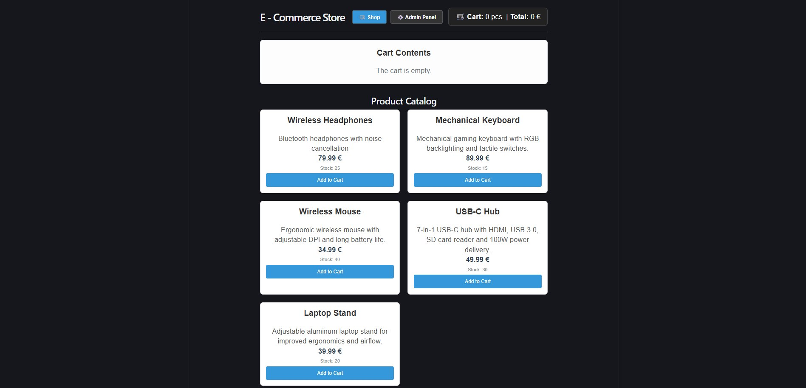
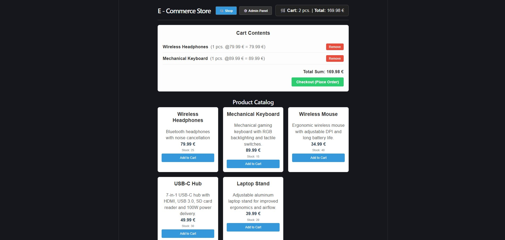
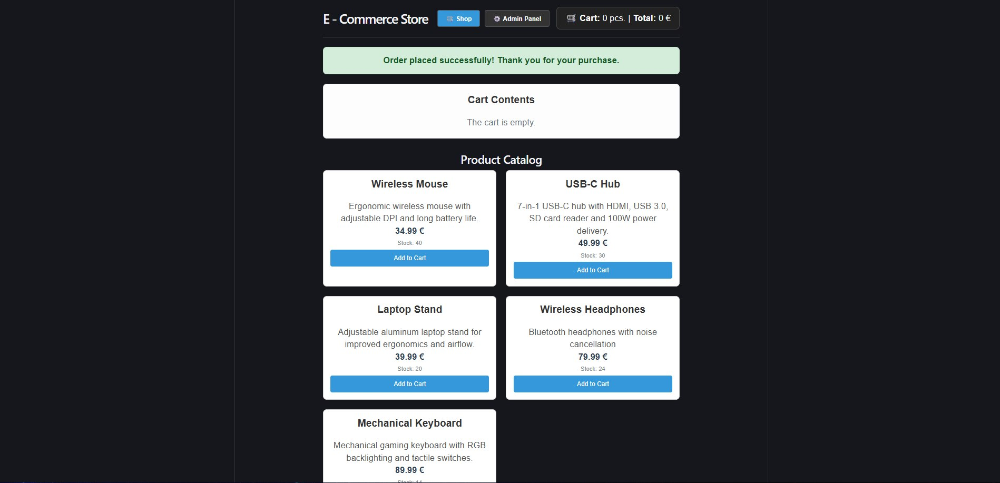
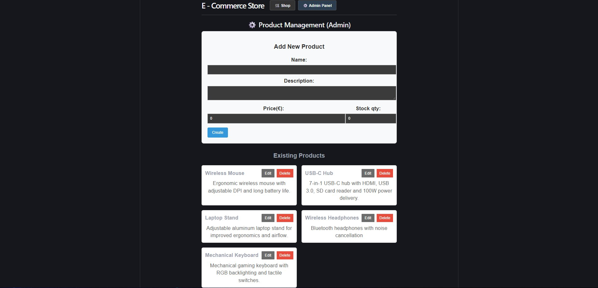
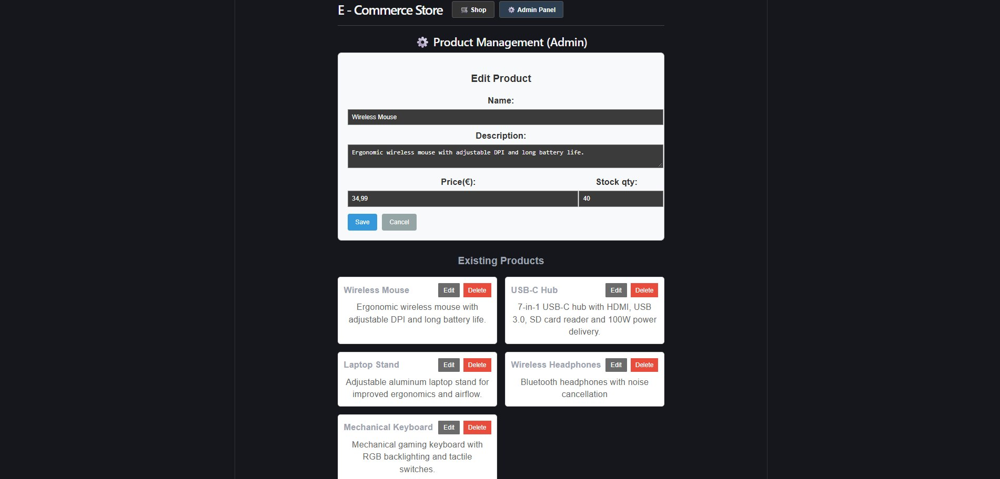
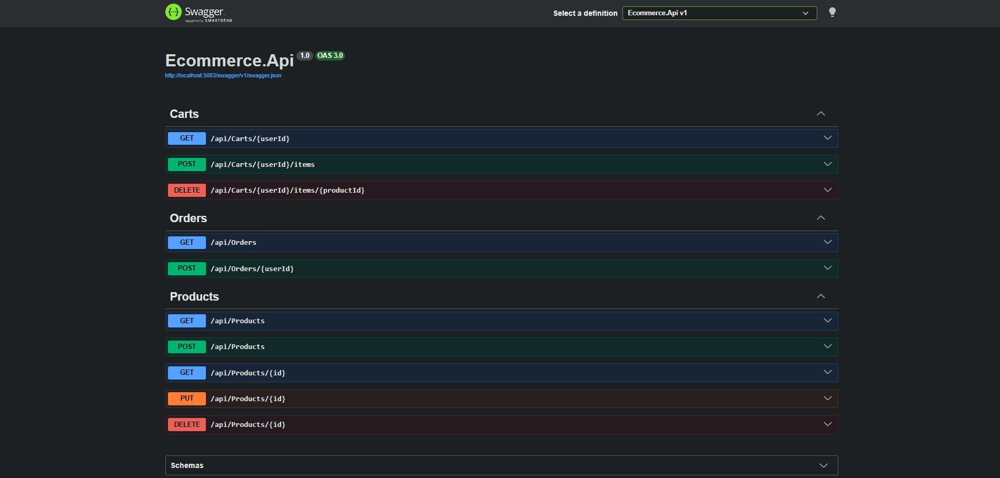
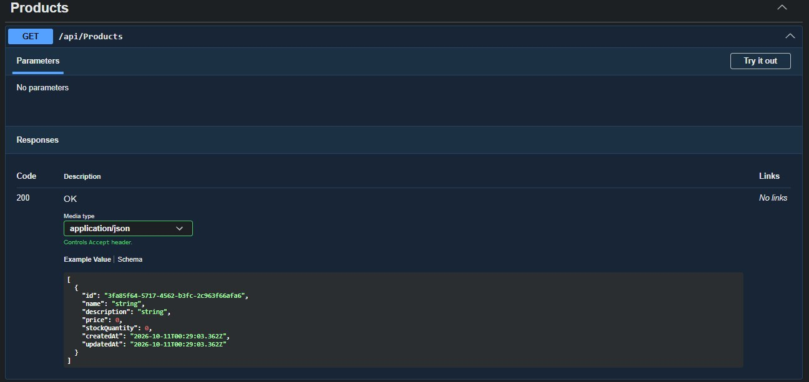
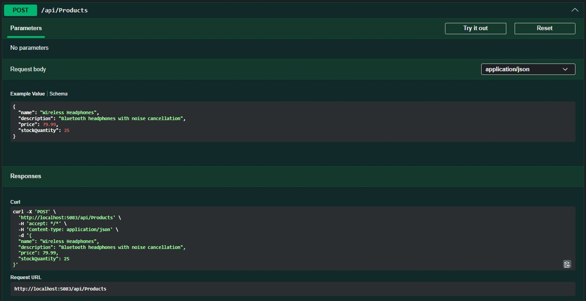
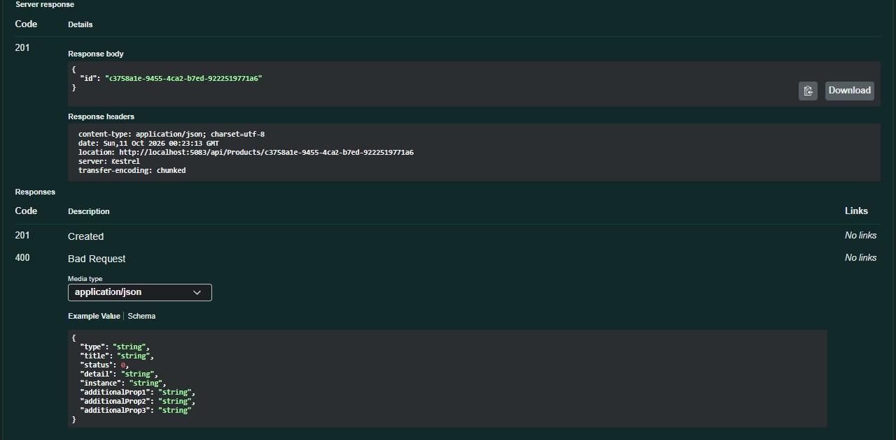

# Mini E-Commerce – Full-Stack Web Application

Eine containerisierte E-Commerce-Webanwendung mit **C#, ASP.NET Core 10, React, TypeScript und PostgreSQL**. Das Projekt demonstriert die Entwicklung einer REST-API, die Speicherung relationaler Daten sowie typische Abläufe eines Online-Shops – von der Produktverwaltung über den Warenkorb bis zur Bestellung.

## Inhaltsverzeichnis

- [Projektübersicht](#projektübersicht)
- [Screenshots](#screenshots)
- [Technologie-Stack](#technologie-stack)
- [Architektur und Projektstruktur](#architektur-und-projektstruktur)
- [Funktionalitäten](#funktionalitäten)
- [Installation und Start](#installation-und-start)
- [REST-API und Swagger](#rest-api-und-swagger)
- [Mögliche Erweiterungen](#mögliche-erweiterungen)

---

## Projektübersicht

Die Anwendung verbindet ein React-Frontend mit einem ASP.NET-Core-Backend und einer PostgreSQL-Datenbank. Produkte können angezeigt und verwaltet werden. Kunden können Produkte in einen Warenkorb legen und Bestellungen aufgeben.

Die Komponenten werden mithilfe von Docker Compose gemeinsam gestartet.

**Projektziele:**

- Entwicklung einer REST-API mit C# und ASP.NET Core
- Strukturierung des Backends in mehrere Verantwortungsbereiche
- Datenpersistenz mit Entity Framework Core und PostgreSQL
- Umsetzung grundlegender E-Commerce-Funktionalitäten
- Integration eines TypeScript-Frontends
- Containerisierung mit Docker Compose
- Dokumentation und Testen der API mit Swagger UI

## Screenshots

### 1. Produktkatalog

Der Produktkatalog zeigt die verfügbaren Produkte und deren Preise.



### 2. Warenkorb

Der Warenkorb fasst ausgewählte Produkte und deren Mengen zusammen.



### 3. Bestellabschluss

Die Anwendung bestätigt den erfolgreichen Abschluss einer Bestellung.



### 4. Produktformular

Das Formular ermöglicht die Eingabe und Bearbeitung von Produktdaten.



### 5. Produktverwaltung

Die Verwaltungsoberfläche zeigt die verfügbaren Produkte und die zugehörigen Verwaltungsaktionen.



### 6. Swagger UI – API-Übersicht

Swagger UI dokumentiert die verfügbaren API-Endpunkte und ermöglicht das Testen von HTTP-Anfragen.



### 7. GET-Endpunkt – Produkte abrufen

Beispiel für das Abrufen von Produktdaten über die REST-API.



### 8. POST-Endpunkt – Produkt anlegen

Beispiel für eine Anfrage zum Anlegen eines Produkts.



### 9. POST-Endpunkt – API-Antwort

Beispiel für die Antwort der API nach dem Absenden einer Anfrage.



---

## Technologie-Stack

### Backend

- C#
- ASP.NET Core 10 Web API
- Entity Framework Core
- REST-API
- Swagger / OpenAPI

### Frontend

- React
- TypeScript
- Vite
- CSS

### Datenbank und Infrastruktur

- PostgreSQL 15
- Docker
- Docker Compose
- Nginx für die Bereitstellung des Frontends

---

## Architektur und Projektstruktur

Das Backend ist in mehrere Verantwortungsbereiche gegliedert. Die API verarbeitet HTTP-Anfragen, die Anwendungsschicht enthält anwendungsbezogene Komponenten, die Domänenschicht bildet fachliche Modelle ab und die Infrastruktur übernimmt technische Aufgaben wie den Datenzugriff.

Die Struktur orientiert sich an den Prinzipien einer geschichteten Architektur.

```text
EcommerceBackend/
├── Ecommerce.Domain/
│   └── Fachliche Modelle und Domänenlogik
├── Ecommerce.Application/
│   └── DTOs, Anwendungslogik und Interfaces
├── Ecommerce.Infrastructure/
│   └── Datenzugriff und Persistenz
├── Ecommerce.Api/
│   └── REST-Controller und API-Einstiegspunkt
├── ecommerce-frontend/
│   └── React-, TypeScript- und CSS-Anwendung
├── screenshots/
│   └── Screenshots der Anwendung und API
├── docker-compose.yml
├── .env.example
├── .gitignore
└── README.md
```

---

## Funktionalitäten

### Produktkatalog und Verwaltung

- Produkte abrufen und anzeigen
- Produktdaten anlegen und bearbeiten
- Produkte über die Verwaltungsoberfläche verwalten
- Produktdaten in PostgreSQL speichern

### Warenkorb und Bestellungen

- Produkte in den Warenkorb legen
- Ausgewählte Produkte und Mengen anzeigen
- Bestellungen über den Checkout aufgeben
- Bestellinformationen im Backend verarbeiten

### Backend und Datenbank

- REST-Endpunkte für die Kommunikation zwischen Frontend und Backend
- Datenbankzugriff mit Entity Framework Core
- Persistenz mit PostgreSQL
- Interaktive API-Dokumentation mit Swagger UI

### Containerisierung

- Gemeinsamer Start der konfigurierten Dienste über Docker Compose
- Separater Datenbankcontainer
- Containerisiertes Backend und Frontend

---

## Installation und Start

### Voraussetzungen

- [Git](https://git-scm.com/)
- [Docker Desktop](https://www.docker.com/products/docker-desktop/)

### 1. Repository klonen

```bash
git clone https://github.com/romsches/mini-e-commerce.git
cd mini-e-commerce
```

### 2. Umgebungsvariablen konfigurieren

Erstelle eine lokale `.env`-Datei anhand der Beispieldatei.

Unter Windows PowerShell:

```powershell
Copy-Item .env.example .env
```

Passe die Werte in `.env` an:

```dotenv
POSTGRES_DB=EcommerceDb
POSTGRES_USER=postgres
POSTGRES_PASSWORD=CHANGE_ME
```

Ersetze `CHANGE_ME` durch ein eigenes Datenbankpasswort. Die lokale `.env`-Datei darf nicht in das öffentliche Repository hochgeladen werden.

**Hinweis:** Bei einem bereits initialisierten PostgreSQL-Datenbankvolume kann weiterhin das ursprünglich verwendete Passwort erforderlich sein.

### 3. Anwendung starten

Starte Docker Desktop und führe im Projektverzeichnis aus:

```bash
docker compose up --build
```

### 4. Anwendung öffnen

| Komponente | Adresse |
|---|---|
| Frontend | http://localhost:5173 |
| Backend und Swagger UI | http://localhost:5083/swagger |

Zum Stoppen der Container:

```bash
docker compose down
```

Dieser Befehl entfernt nicht ausdrücklich das Datenbankvolume.

---

## REST-API und Swagger

Die API kann über Swagger UI erkundet und getestet werden.

**Swagger UI:** http://localhost:5083/swagger

Dort lassen sich die dokumentierten Endpunkte aufrufen, Request-Daten übermitteln und die Antworten des Backends überprüfen.

Die Screenshots oben zeigen beispielhaft die API-Übersicht, das Abrufen von Produkten und das Anlegen eines Produkts.

---

## Mögliche Erweiterungen

- Unit- und Integrationstests
- Authentifizierung und rollenbasierte Autorisierung
- Erweiterte Such-, Filter- und Sortierfunktionen
- Erweiterte Bestellverwaltung
- CI/CD-Pipeline
- Cloud-Deployment
- Zusätzliche Sicherheits- und Performance-Tests

Diese Punkte sind mögliche Erweiterungen und keine Aussage über bereits implementierte Funktionen.

---

## Repository

**GitHub:** https://github.com/romsches/mini-e-commerce